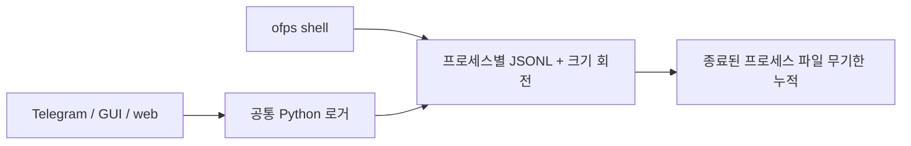
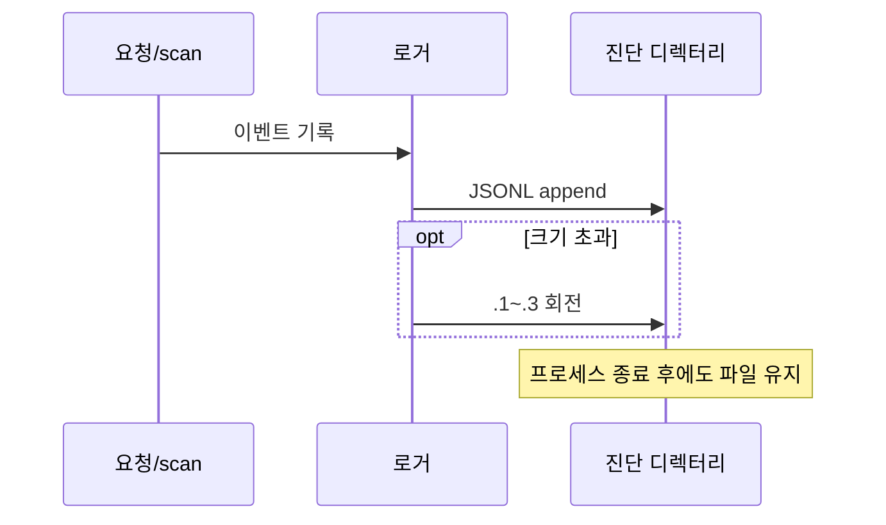
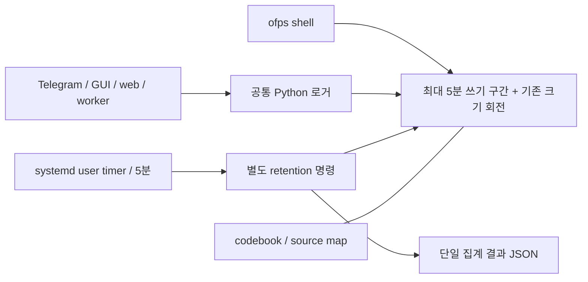
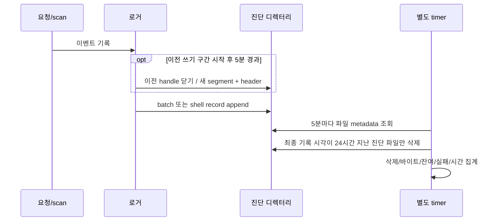

# 진단 로그 24시간 보관 (#31)

- Issue: https://github.com/jo0n-lab/cfd-bot/issues/31
- 상태: 사전 설계 후 구현·검증. [측정 결과](../analysis/diagnostic-retention-performance.md).
- 배경: 2026-10-16 조사에서 진단 JSONL 87,590개, 약 5.33 GiB. 수정 시각 기준 24시간 경과분은 약 4.91 GiB다. 기존 작업 공간의 티켓 변경은 별도 유지한다.

## As-Is HLD

## As-Is LLD

## To-Be HLD

## To-Be LLD

## 보관 계약·호환성

- 기록 완료 시각(파일 mtime)을 기준으로 24시간이 지난 파일을 정리한다. 파일 내부를 매번 해독·재작성하지 않는다. 최신 기록을 포함한 파일은 통째로 보존한다.
- 새 Python/shell 파일은 5분마다 다음 쓰기 전에 새 segment로 전환한다. 기존 크기 회전 정책도 유지한다. 정상 timer 운용 시 새 기록의 최대 보관 지연은 24시간 + segment 5분 + timer 5분/1초 정확도 + 정리 실행 시간이다. 파일 크기 회전에 따른 조기 제거는 기존 설정과 같다.
- 새 segment는 같은 instance/trace와 독립 header를 사용한다. idle 중 지워진 만료 segment에는 다시 쓰지 않고 다음 기록 전에 새 segment를 연다.
- 이전 버전의 열린 파일은 /proc FD 조사로 보존한다. 장기 실행 구버전 로거는 재시작 전까지 유예되며 이를 집계로 알린다. 이미 새·옛 기록이 섞인 legacy 파일은 마지막 기록 후 24시간까지 보존한다.
- collector는 진단 디렉터리 최상위의 지정된 이름·header를 가진 일반 파일만 대상으로 삼는다. symlink·하위 디렉터리·solver 로그·티켓·DB·별도 조사 자료는 제외한다. 이는 삭제 대상의 정의이며 업무 정책을 추가하는 것이 아니다.
- codebook/source map은 자동 삭제하지 않는다. 과거 기록의 해독 및 실행 중인 프로세스가 참조하는 사전을 보존한다. 사전은 로그 발생마다 생성되지 않고 버전 hash별로 공유된다. 불필요한 과거 사전은 보존 로그와 실행 중인 구버전 프로세스가 없음을 확인한 뒤 별도 수동 정리한다.
- 요청/scan마다 디렉터리를 순회하지 않는다. 정리는 별도 프로세스에서 5분마다 실행하고 중복 실행은 파일 잠금으로 합친다. 로그 OFF에서도 기존 파일 정리는 timer가 계속 수행한다.
- Telegram·GUI·web은 동일 Python sink를 사용하며 브라우저 메모리 순환 버퍼/사용자가 내보낸 파일의 보관 정책은 바꾸지 않는다.
- collector CLI의 기본 실행은 dry-run, `--apply`만 삭제한다. 단일 JSON 집계는 삭제 수·회수 byte·잔여 수·잔여 byte·열린 legacy 유예·실패·wall/CPU/I/O 카운터를 제공한다. timer는 매번 상세 파일 로그를 만들지 않는다. journal 접근 권한이 없는 호스트에서도 조회하도록 마지막 집계만 `retention-status.json`으로 원자 교체한다.
- #32 로거 자체 비용, #33 스마트폰/DB 계측, 업무 안전·검증·복구 로직은 포함하지 않는다.

## 검증·적용 계획

1. 만료 경계·신규/legacy·회전·혼합 파일·열린 legacy·symlink/비대상 보존·dry-run·동시 실행을 테스트한다.
2. Python/shell 시간 회전 후 trace/해독/반환 코드가 유지되는지 검증한다.
3. 1.45만 파일 fixture의 wall/CPU/I/O 비용과 요청 경로의 회전 검사 비용을 비교한다.
4. compileall, 전체 unittest, 실제 bot 설정 check, SVG XML parse 및 렌더링을 확인한다.
5. 실제 누적 디렉터리 dry-run 결과를 확인한 뒤 만료 파일을 정리하고 timer를 설치한다. 서비스 재시작 후 신규 segment와 timer 상태를 확인한다.
