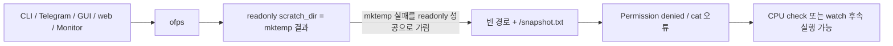
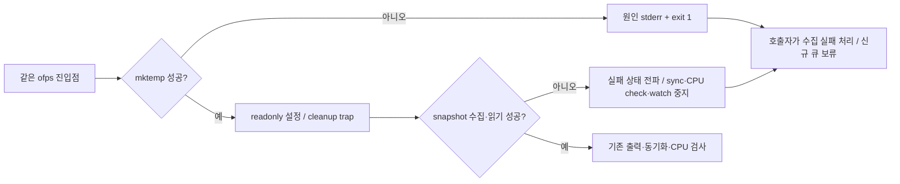

# ofps 임시 디렉터리 생성 실패 시 즉시 종료

- 요청: `/tmp` 공간 부족으로 `mktemp`가 실패한 뒤 `/snapshot.txt`를 참조하는 오류 수정.
- GitHub Issue: 앞선 사용자 지시에 따라 별도 등록 생략.
- 범위: 공용 `bin/ofps`의 임시 파일 준비·수집 실패 전파. 디스크 정리, TMPDIR 변경, 파티션 변경은 포함하지 않는다.

## As-Is HLD / LLD

`readonly scratch_dir=$(mktemp ...)`는 선언 명령의 성공 상태로 치환 내부 실패를 덮는다. `scan_and_sync`는 실패한 snapshot도 cat/sync하려 하고, `--check`는 scan의 실패 상태를 확인하지 않는다.

## To-Be HLD / LLD

- `scratch_dir=$(mktemp ...)`의 결과를 먼저 검사하고 성공한 경우에만 readonly로 고정한다.
- 기본·check·watch에서 준비 실패를 즉시 종료한다. 준비 실패 시 root 경로 접근 및 수집/DB 동기화는 수행하지 않는다.
- `scan_and_sync`는 파일 생성/scan/cat 실패를 즉시 반환한다. check/watch 호출부는 해당 실패를 종료 코드로 전파한다.
- 초기화 실패도 기존 진단 로거의 shell exit 사건으로 기록한다. 정상 생성 후에는 기존 cleanup trap을 사용한다.
- Telegram/GUI/web는 기존 공용 snapshot/check 경로를 사용하므로 adapter별 규칙을 추가하지 않는다.

## 호환성·검증 계획

CLI 인자, 정상 출력, 설정과 티켓 schema는 동일하다. 실패 시 0/SAFE로 진행할 가능성을 제거한다.

임시 fixture의 `mktemp`를 실패시키거나 사용할 수 없는 경로를 반환하도록 하여 기본/check/watch의 즉시 실패, 2차 `/snapshot.txt` 오류와 SAFE 출력 부재, 진단 ON/OFF, Python snapshot·CPU check까지의 전파를 확인한다. 실제 계산/Telegram 전송은 하지 않는다. 설치된 ofps 링크와 정상 수집도 확인한다.

## 검증 결과

- `bash -n bin/ofps`, `compileall`, 운영 `bot.json check` 통과.
- 실패 회귀 4개 테스트: 기본/check/별칭/watch × 진단 OFF/basic/detailed, snapshot 생성 실패, 공용 Python snapshot·CPU check의 실패 전파, help 확인. 초기화 실패의 shell.exit 로그도 확인했다.
- 현재 작업 트리의 전체 416개 테스트: 415 통과, GUI display가 필요한 1개 skip. 실제 Telegram 전송/OpenFOAM 계산 시작 없이 수행했다.
- BG-01 SVG 재생성, XML parse 및 PNG 렌더 확인.
- 설치된 `/home/joon/.local/bin/ofps`가 수정한 `bin/ofps`를 가리키며 실제 수집 exit 0을 확인했다. 해당 확인은 managed 모드로 DB/티켓 동기화 없이 수행했다.
- `cfd-bot.service` 재시작 후 `active/running`, `ExecMainStatus=0`을 확인했다.
