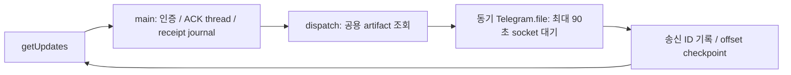

# Telegram 파일 전송 지연 격리

- 배경: 11월 3일 Shape/Residual 전송에서 각각 71.61/71.03초가 소요됐다. 같은 요청의 파일 검색은 1ms 미만, 수신 기록은 48~105ms였다. 24시간 이미지 전송 73건의 중앙값은 2.85초이며, 느린 파일 뒤의 callback이 만료됐다.
- GitHub Issue: 앞서 지정한 사용자 요청에 따라 생략.
- 범위: Telegram의 파일 전달 adapter와 HTTP 진단. 공용 TicketService·artifact 경로 검증·계산 실행 정책은 바꾸지 않는다. GUI의 결과 경로 목록과 web 다운로드는 같은 artifact helper를 계속 사용한다.

## As-Is HLD / LLD



`serve → Bot.handle → dispatch → Bot.file → Telegram.file`이 순차 실행된다. ACK도 다음 update를 처리할 때에야 시작한다. 같은 파일의 중복 요청을 합치지 않는다. API 함수 전체 시간만 있어 연결·업로드·응답 지연을 구분할 수 없다.

## To-Be HLD / LLD

```mermaid
flowchart LR
  U[getUpdates] --> H[main: 인증 / ACK / receipt]
  H --> D[기존 공용 artifact 조회]
  D --> Q{파일 요청: 제한된 queue}
  Q -->|접수 / 중복 병합| O[offset checkpoint / 다음 update]
  O --> U
  Q --> W[독립 파일 worker 2개]
  W --> T[연결 / 전송 / 응답 단계별 계측]
  T --> R[송신 ID를 기존 receipt journal에 기록]
  C[/clean] --> X[해당 chat의 대기 전송 취소 / 세대 증가]
  X --> Y[기존 메시지 일괄 삭제]
  R --> Z{clean 이전 요청?}
  Z -->|예| L[늦게 전송된 메시지도 삭제]
```

- `TelegramTransfers`: active+pending 최대 16개, 고정 daemon worker 2개. chat·clean 세대·파일 경로·형식이 같은 active/pending 요청은 병합한다. 대기 중 재요청은 최신 FileItem을 사용한다. 완료 후의 새 요청은 다시 허용한다. 용량 초과는 JSON 문구로 안내하며 무제한 thread/queue를 만들지 않는다.
- 티켓 편집/실행/중단/삭제는 기존 main 순서를 유지한다. 파일 worker는 API 전송·receipt 기록만 수행하고 TicketChat session/domain을 수정하지 않는다. 자동 알림은 기존 SQLite outbox/전달 thread를 계속 사용한다.
- `/clean`은 pending 파일 취소 후 기존 receipt barrier를 수행한다. 이미 네트워크에 보낸 파일의 반환 ID도 세대로 판별해 삭제하여 대화를 다시 채우지 않는다.
- 대화형 파일 전송 실패는 기존 logger와 JSON 오류 안내를 사용한다. 전송 성공 여부가 모호한 네트워크 오류에 자동 재전송하지 않는다. 종료 시 pending은 취소하고 active worker는 제한된 시간만 join한다. 대화형 queue는 프로세스 메모리이며 재시작 후 자동 재생하지 않는다. 자동 알림의 영속 outbox 계약은 유지한다.
- HTTP transport는 urllib의 proxy/TLS 검증을 유지한다. 연결(DNS/TCP/TLS 포함), 요청 전송, 응답 header/body, 파일 준비 시간을 기존 진단 logger로 기록한다. URL·token·payload는 기록하지 않는다. 연결 socket timeout은 10초, 응답 대기는 20초로 제한하며 큰 파일의 전송 timeout은 기존 90초를 유지한다. DNS 자체의 OS resolver deadline은 별도 보장하지 않는다.

## 호환성·검증 계획

티켓/DB schema 변경 없음. Telegram 고정 문구는 scenarios/data.json과 manifest에서 관리한다. Bot을 직접 쓰는 테스트/도구는 dispatcher 미주입 시 기존 동기 file 계약을 유지한다. GUI/web의 artifact 결과·경로 제한은 그대로이며 기존 공용/플랫폼 테스트를 함께 실행한다.

가짜 API를 Event로 멈춰도 `/stat`과 다음 요청이 진행되는지, 서로 다른 파일이 병렬 전송되는지, 동일 요청 병합·최대 용량·실패 후 재요청·clean 도중 늦은 성공·종료를 확인한다. HTTP는 mock/local fixture로 타이밍·timeout·token 비노출을 확인하고 실제 Telegram 메시지나 계산을 시작하지 않는다. compileall/전체 unittest/config check, 변경 SVG parse·render 후 봇을 재시작한다.

## 검증·적용 결과

- 현재 작업 트리의 전체 427개 테스트: 426 통과, GUI display 의존 1개 skip. compileall 및 운영 bot.json check 통과.
- 추가 회귀: 전송 정지 중 실제 Bot.handle의 stat·다른 파일·receipt checkpoint 진행, 중복 병합·용량·재요청, clean의 pending 취소·늦은 성공 삭제, 실패 안내·worker 유지, bounded 종료, 대기 중 symlink 변경 거부를 확인했다.
- HTTPS mock으로 실제 urllib handler의 요청/응답, TLS 검증 설정, 연결/전송/응답 timeout, 단계별 기록과 token 비노출을 확인했다. 토큰 없는 공개 API URL로 TLS/HTTP 200도 확인했다. 테스트 메시지와 계산은 실행하지 않았다.
- 변경 SVG 30개 XML parse·렌더 및 대표 Residual/HLD 이미지 확인. HLD/LLD/architecture, 문구 manifest, 사용 예시 반영.
- 2026-11-03 10:44 KST 봇 서비스 재시작 후 active/running, ExecMainStatus=0, PID 3089431 확인. 새 로그에서 getMe/getWebhookInfo/getUpdates 및 Monitor 반복 성공, transport phase 기록, 예외 없음 확인. 실제 사용자 파일 요청의 전송 시간 개선치는 아직 측정하지 않았다.
